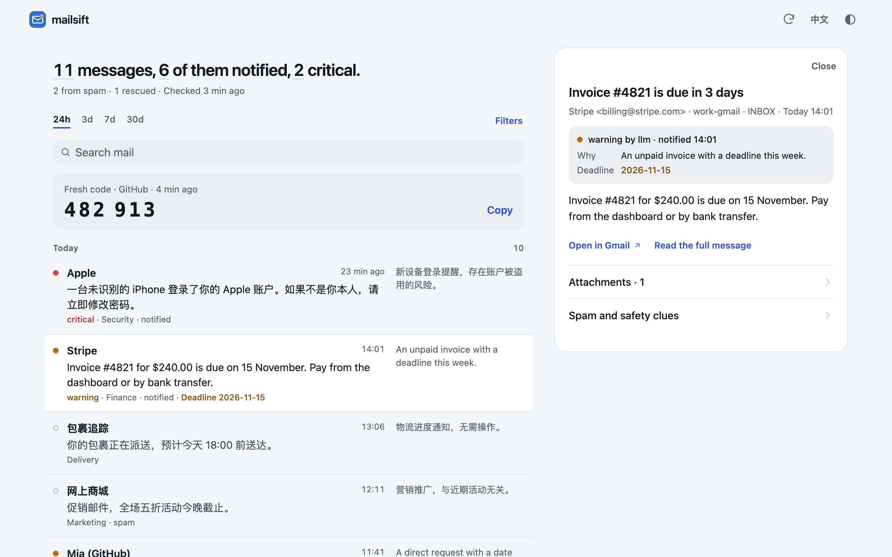
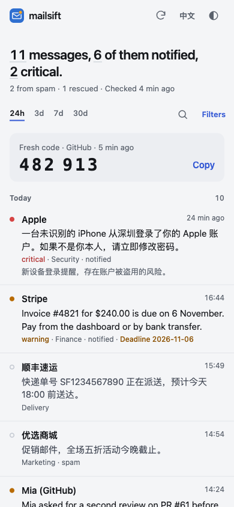

# mailsift

mailsift watches all your IMAP mailboxes, spam folders included. It judges each new message with your own rules and an LLM, pushes the ones that matter to Feishu or a webhook, and gathers the rest into a daily digest. Its web view is a mail client built on that judgement: it opens on what needs you, and you read, file and answer it there.



> mailsift reads your mail and changes nothing unless you give it a second, write token. With one, the web view can file, bin and answer mail, an MCP client holding it can do the same, and every such action is audited. Classification can be wrong, so keep your provider's mailbox as the source of truth.

中文文档：[README.zh-CN.md](README.zh-CN.md)。

## Features

- **Every mailbox, spam included.** Any IMAP provider and any number of accounts, Gmail and Outlook through OAuth. Spam folders are found per provider and checked like the inbox.
- **Judged, not just filtered.** Your sender rules decide first; an LLM rates the rest critical, warning or info, with a one-line summary and the reason. Without an LLM, or while it fails, keyword rules keep mail moving.
- **Pushed when it matters.** Important mail goes to Feishu or your webhook as soon as mailsift sees it, within seconds with IMAP IDLE. The rest waits for one daily digest.
- **Codes at a glance.** A verification code is shown in the Feishu card and, in the web view, as one large copy button. Codes and sign-in links never reach the LLM.
- **A mail client built on the triage.** The web view opens on what needs you. Read each message as it was sent, safely; mark it done, archive it or answer it; ask a question across your mail. It installs to a phone's home screen and notifies you there.
- **An MCP server**, so an AI assistant can see what needs you, and list, search and read your triaged mail.
- **Says when it cannot see.** Alerts when a mailbox or the LLM keeps failing, and an optional heartbeat lets an outside monitor notice if mailsift itself stops.

## Quick start

You need Docker with Compose.

```bash
git clone https://github.com/itswl/mailsift.git
cd mailsift
cp .env.example .env
```

Edit `.env`. These lines are the minimum; the rest of `.env.example` can stay as it is for now.

```bash
# A mailbox: provider|address|password. The password is usually an app password.
MAIL_ACCOUNT_1=qq|me@qq.com|app-password

# Where important mail goes: a Feishu bot, a webhook (WEBHOOK_URL), or both.
FEISHU_WEBHOOK_URL=https://open.feishu.cn/open-apis/bot/v2/hook/...

# The LLM. Leave the key empty to run on keyword rules alone.
LLM_PROVIDER=deepseek
LLM_API_KEY=

# Docker needs a token for its MCP and web port: any long random string,
# for example the output of `openssl rand -hex 32`.
MCP_TOKEN=
```

Compose runs the `latest` image. To upgrade only when you choose, also pin a release in `.env`, such as `MAILSIFT_VERSION=0.1.99`; the Releases page lists them.

Start it and follow the log:

```bash
docker compose up -d
docker compose logs -f
```

`docker compose run --rm mailsift node dist/src/main.js --check` validates the configuration without polling.

Without Docker, use Node 22.5 or newer: `npm install`, `npm run check`, then `npm run dev`.

## Settings worth a look

[.env.example](.env.example) lists every setting with a short explanation. The ones most people change:

- `MAIL_ACCOUNT_N_NAME`, `MAIL_ACCOUNT_N_FOLDERS`: a mailbox's display name, and which folders to watch: `INBOX,spam` (the default), `all`, or folder names.
- `MAIL_CONTEXT`: one sentence about you and what you want pushed. The LLM reads it with every message.
- `MAIL_ALWAYS_IMPORTANT`, `MAIL_NEVER_IMPORTANT`: senders always marked critical or info, such as `@bank.com`.
- `PUSH_MIN_IMPORTANCE`: the lowest level pushed in real time (default `warning`).
- `LLM_OUTPUT_LANGUAGE`: the language of summaries: `en`, `zh-CN`, `auto` or any language name.
- `DIGEST_HOUR`: the digest's hour on the server's clock (default `9`). Set `TZ` to your time zone.
- `IMAP_IDLE_ENABLED=true`: wake on new mail instead of waiting for the next poll.
- `WEB_UI_ENABLED=true`: the [web view](#web-view).
- `MCP_WRITE_TOKEN`: a second token that lets the web view and MCP act on mail. Without it mailsift only reads.

[docs/configuration.md](docs/configuration.md) explains them in depth.

## Gmail and Outlook

Most Gmail and Outlook accounts need OAuth instead of a password. Add the account without one (`MAIL_ACCOUNT_2=gmail|me@gmail.com`, or `outlook|…`), then authorize it once:

```bash
docker compose run --rm mailsift node dist/scripts/oauth-setup.js --manual
```

It prints a URL: open it on any computer, approve access, and paste the address you are redirected to back into the terminal. Outside Docker, `npm run oauth` does the same in a local browser.

Two guides in Discussions cover the provider side:

- [Authorising Gmail and Outlook](../../discussions/46), step by step against the scopes and redirect this code actually uses, including the two traps that cost the most time: a Google consent screen left in Testing expires refresh tokens every 7 days, and Outlook.com ships with IMAP switched off.
- [Forwarding](../../discussions/47), which is how to skip Gmail's OAuth altogether by forwarding the whole mailbox to an account that uses a password.

Personal Gmail can also use `gmail_pw` with an app password; Google Workspace cannot.

## Web view

Set `WEB_UI_ENABLED=true` and open `http://<host>:8410/` (the `MCP_PORT`). Sign in with `MCP_TOKEN` to read, or with `MCP_WRITE_TOKEN` to act on mail as well; the browser stays signed in.

- **What needs you** comes first: mail judged important that you have not dealt with. Tick it off, swipe it away, or open it.
- **Read** a message as it was sent. Remote images wait until you ask, tracking pixels are dropped, a link that goes somewhere other than it says is marked, and your provider's verdict on the sender is shown.
- **Act**: done, archive, bin, star, not spam. Reply, forward or write a new message, with Cc and Bcc, attachments (pasted pictures too), a signature for each mailbox, a first draft from the model if you want one and five seconds to undo a send.
- **Ask** a question across your mail and get an answer that cites the messages it came from.
- **Codes** are set large and copy on tap. On a phone, the **Latest code** home-screen shortcut opens on the newest one and waits for one still on its way.
- **Notifications** on your phone or desktop for codes and important mail, and a list that updates as mail is judged.
- `⌘K` opens a command palette, and `?` lists the keys.



Docker publishes the port on the host's loopback address only. To reach it from a phone, put a reverse proxy with TLS in front (and set `TRUSTED_PROXY=true`) or use a tunnel; notifications and installing need HTTPS. More in [docs/web-view.md](docs/web-view.md).

## MCP

The MCP server runs inside mailsift at `http://127.0.0.1:8410/mcp` (Streamable HTTP, `Authorization: Bearer <MCP_TOKEN>`). Add it to an MCP client and an assistant can see what needs you, list, search and read your triaged mail, preview the digest, or check mailbox health. It also ships the workflows those tools are meant to be used in, as prompts: catch up on the mailbox, or work out why something never reached you. It is read-only; a separate `MCP_WRITE_TOKEN` gives an assistant what the web view's owner has: marking mail done, filing and binning it, and sending and forwarding mail, all audited. Give that token only to a client you would hand your mailbox to. An agent that supports skills can load [.agents/skills/mailsift/SKILL.md](.agents/skills/mailsift/SKILL.md). See [docs/mcp.md](docs/mcp.md).

## Everyday commands

```bash
docker compose logs -f                                          # follow the log
docker compose pull && docker compose up -d                     # upgrade (raise MAILSIFT_VERSION first if pinned)
docker compose run --rm mailsift node dist/src/main.js --check  # validate the configuration
```

Every command and flag is in [docs/deployment.md](docs/deployment.md#commands).

## Documentation

- [Configuration](docs/configuration.md): mailboxes and folders, outputs, push thresholds, your own rules, the digest, polling limits, IMAP IDLE, alerts.
- [Triage](docs/triage.md): how mail is judged, the LLM and what it sees, two-stage triage, fallback, verification codes and sign-in links.
- [Web view](docs/web-view.md): the queue, reading and what keeps it safe, acting, writing, asking, notifications, the keyboard, and how the page is protected.
- [MCP](docs/mcp.md): tools, resources, the write token, attachments, safety clues, audit.
- [Deployment and operations](docs/deployment.md): Docker, upgrades, systemd, OAuth details, commands, monitoring, recovery.
- [Troubleshooting](docs/troubleshooting.md)
- [Signal event v1](docs/signal-event-v1.md): the `signal` object in webhook payloads.
- [Development](docs/development.md)

## License

MIT
