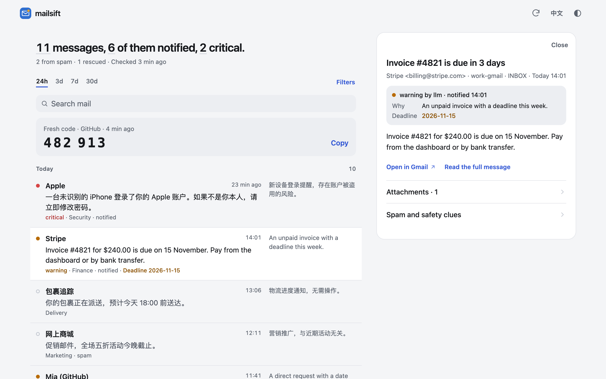
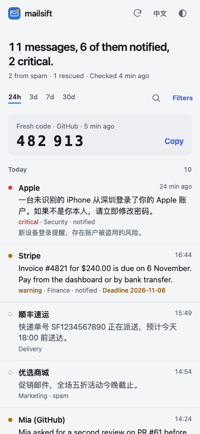

# mailsift

mailsift watches all your IMAP mailboxes, spam folders included. It judges each new message with your own rules and an LLM, pushes the ones that matter to Feishu or a webhook, and gathers the rest into a daily digest. Its web view is a mail client built on that judgement: it opens on what needs you, and you read, file and answer it there.



> mailsift reads your mail. Signed in with the administrator password, the web view can also file, bin and answer it, and so can an MCP client you give the write token; every such action is audited. Classification can be wrong, so keep your provider's mailbox as the source of truth.

中文文档：[README.zh-CN.md](README.zh-CN.md)。

## Features

- **Every mailbox, spam included.** Any IMAP provider and any number of accounts, Gmail and Outlook through OAuth. Spam folders are found per provider and checked like the inbox.
- **Judged, not just filtered.** Your sender rules decide first; an LLM rates the rest critical, warning or info, with a one-line summary and the reason. Without an LLM, or while it fails, keyword rules keep mail moving.
- **Pushed when it matters.** Important mail goes to Feishu or your webhook as soon as mailsift sees it, within seconds with IMAP IDLE. The rest waits for one daily digest.
- **Codes at a glance.** A verification code is shown in the Feishu card and, in the web view, as one large copy button. Codes and sign-in links never reach the LLM.
- **A mail client built on the triage.** The web view opens on what needs you. Read each message as it was sent, safely; mark it done, archive it or answer it, one or many at a time; open any folder or search the whole mailbox, live; ask a question across your mail. It installs to a phone's home screen and notifies you there.
- **An MCP server**, so an AI assistant can see what needs you, list, search and read your triaged mail, and reach the rest of the mailbox live.
- **Says when it cannot see.** Alerts when a mailbox or the LLM keeps failing, and an optional heartbeat lets an outside monitor notice if mailsift itself stops.

## Quick start

You need Docker with Compose. There is no configuration file to write: everything is set up in the browser.

```bash
git clone https://github.com/itswl/mailsift.git
cd mailsift
docker compose up -d
docker compose logs mailsift
```

The log shows the setup address and a one-time setup code. Open `http://127.0.0.1:8410/`, enter the code and choose an administrator password. Then add your mailboxes (**Test connection** checks each one and lists its folders), optionally an AI model and a Feishu bot or webhook, and press **Start mailsift**. Until then nothing connects to a mailbox.

On a remote server, open an SSH tunnel from your computer first and use the same address there:

```bash
ssh -N -L 8410:127.0.0.1:8410 you@your-server
```

The port is published on the server's loopback address only, and mailsift accepts passwords and tokens only from a local address or over HTTPS. For everyday use from a phone or another computer, put an HTTPS reverse proxy in front; see [Deployment](docs/deployment.md#reaching-it-from-another-computer).

Gmail and Outlook sign in with OAuth, through an OAuth app you register once with Google or Microsoft; see [Gmail and Outlook sign-in](docs/deployment.md#gmail-and-outlook-sign-in). A personal Gmail account can use an app password instead, or be forwarded into a mailbox that signs in with a password ([Forwarding between mailboxes](docs/configuration.md#forwarding-between-mailboxes)). Both are walked through step by step in the discussions [Gmail / Outlook OAuth sign-in](../../discussions/99) and [Mail forwarding](../../discussions/100).

## Settings

Everything else is in Settings (the gear in the web view): mailboxes, the AI model, notifications, triage rules, checking and the daily digest, privacy and retention, web mail, MCP tokens and limits. Values are checked when saved, the AI model and notifications can be tested before saving, and secrets are never shown again once saved. A change the running service depends on restarts it on its own, after the poll in progress. Settings and credentials live encrypted in the Docker volumes; back them up together. See [Configuration](docs/configuration.md).

## Web view

Open the page and sign in with the administrator password.

- **What needs you** comes first: mail judged important that you have not dealt with. Tick it off, swipe it away, put it off until later (it comes back when you said, with a notification), or open it.
- **Read** a message as it was sent. Remote images wait until you ask, tracking pixels are dropped, a link that goes somewhere other than it says is marked, and your provider's verdict on the sender is shown.
- **The whole conversation** under each message, your own replies included, read from your Sent folder. A message you answered from another mail app leaves what needs you, and the people you write to are suggested as you type.
- **Act**: done, archive, bin, star, not spam. Reply, forward or write a new message, with Cc and Bcc, attachments (pasted pictures too), a signature for each mailbox, a first draft from the model if you want one and five seconds to undo a send.
- **Ask** a question across your mail and get an answer that cites the messages it came from.
- **Codes** are set large and copy on tap. On a phone, the **Latest code** home-screen shortcut opens on the newest one and waits for one still on its way.
- **Notifications** on your phone or desktop for codes and important mail, and a list that updates as mail is judged.
- `⌘K` opens a command palette, and `?` lists the keys.



Notifications and installing to a home screen need HTTPS (or the page opened at localhost). More in [docs/web-view.md](docs/web-view.md).

## MCP

The MCP server runs inside mailsift at `/mcp` on the same address (Streamable HTTP, `Authorization: Bearer <token>`). Add it to an MCP client and an assistant can see what needs you, list, search and read your triaged mail, preview the digest, or check mailbox health. It also ships the workflows those tools are meant to be used in, as prompts: catch up on the mailbox, or work out why something never reached you. Settings → Access generates the tokens, each shown once: the read token only looks; the write token also gives an assistant what the web view's owner has: marking mail done, putting it off until later, filing and binning it, and sending and forwarding mail, all audited. Give that token only to a client you would hand your mailbox to. A third, the admin token, is made only when you ask for it and gives an assistant what you have in Settings, down to the other tokens: give it only to a client you would hand the settings page to. An agent that supports skills can load [.agents/skills/mailsift/SKILL.md](.agents/skills/mailsift/SKILL.md). See [docs/mcp.md](docs/mcp.md).

## Everyday commands

```bash
docker compose logs -f                                              # follow the log
docker compose pull && docker compose up -d                         # upgrade to the current image
docker compose exec mailsift node dist/src/main.js --check          # report on the stored configuration
docker compose exec mailsift node dist/src/main.js --reset-admin    # forgot the administrator password
```

Every command and flag is in [docs/deployment.md](docs/deployment.md#commands).

## Documentation

- [Configuration](docs/configuration.md): mailboxes and folders, outputs, push thresholds, your own rules, the digest, polling limits, IMAP IDLE, alerts.
- [Triage](docs/triage.md): how mail is judged, the LLM and what it sees, two-stage triage, fallback, verification codes and sign-in links.
- [Web view](docs/web-view.md): the queue, reading and what keeps it safe, acting, writing, asking, notifications, the keyboard, and how the page is protected.
- [MCP](docs/mcp.md): tools, resources, the write token and the admin token, attachments, safety clues, audit.
- [Deployment and operations](docs/deployment.md): Docker, first start, remote access and HTTPS, sign-in, Gmail and Outlook OAuth, backups, upgrades, systemd, commands, monitoring, recovery.
- [Troubleshooting](docs/troubleshooting.md)
- [Signal event v1](docs/signal-event-v1.md): the `signal` object in webhook payloads.
- [Development](docs/development.md)

## License

MIT
