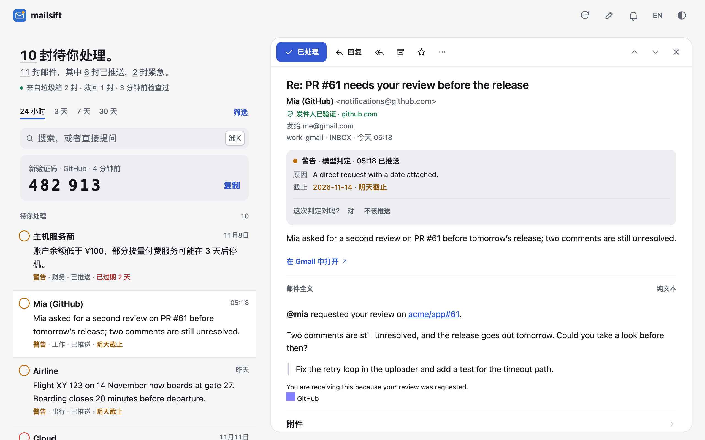
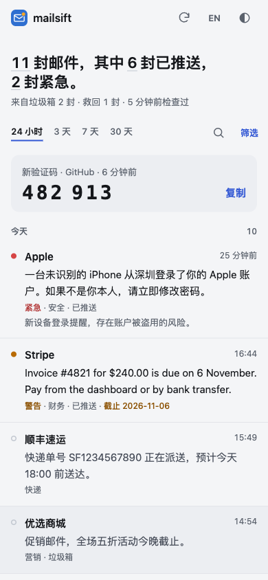

# mailsift（中文说明）

mailsift 统一监控你的所有 IMAP 邮箱，包括垃圾箱。它用你自己的规则和大模型判断每封新邮件，把重要的推送到飞书或通用 Webhook，其余的汇总进每日日报。它的 Web 视图是建立在这些判断之上的邮件客户端：打开就是需要你处理的邮件，阅读、归档、回复都在这里完成。



> mailsift 读取你的邮件。用管理员密码登录后，Web 视图还可以归档、删除和回复邮件；你交给写令牌的 MCP 客户端也能做同样的事，每次操作都有审计。分类结果可能有误，请继续以邮箱服务商那里的邮件为准。

English: [README.md](README.md)。详细文档在 [docs/](docs/) 目录，只有英文版。

## 主要功能

- **所有邮箱，包括垃圾箱。** 支持任意 IMAP 服务商和多个账号，Gmail、Outlook 通过 OAuth 接入。垃圾箱按服务商自动识别，和收件箱一样检查。
- **判断，而不只是过滤。** 先按你的发件人规则判定，其余交给大模型评为紧急、警告或一般，并附一句话摘要和理由。没配大模型或它出错时，由关键词规则兜底，邮件照常处理。
- **重要的及时推送。** 重要邮件一被发现就推送到飞书或 Webhook，开启 IMAP IDLE 后几秒内就到；其余的等每日日报。
- **验证码一眼可见。** 验证码直接显示在飞书卡片里，在 Web 视图里则是一个点一下就复制的大号数字。验证码和登录链接都不会发给大模型。
- **建立在分诊之上的邮件客户端。** Web 视图打开就是需要你处理的邮件。安全地按原貌阅读每封邮件；标记完成、归档或回复，一封或多封一起；实时打开任意文件夹或搜索整个邮箱；就所有邮件向大模型提问。可以添加到手机主屏幕，并在那里收到通知。
- **MCP 服务器**，让 AI 助手可以看到哪些邮件等你处理，列出、搜索和阅读分诊过的邮件，并实时查看邮箱的其余部分。
- **看不到时会说。** 邮箱或大模型持续失败时会告警；可选的外部心跳能让别处的监控发现 mailsift 自己停了。

## 快速开始

需要 Docker 和 Compose。不需要编写任何配置文件，所有设置都在浏览器里完成。

```bash
git clone https://github.com/itswl/mailsift.git
cd mailsift
docker compose up -d
docker compose logs mailsift
```

日志里会显示设置地址和一次性设置码。打开 `http://127.0.0.1:8410/`，输入设置码并设置管理员密码。然后添加邮箱（“测试连接”会登录一次并列出文件夹），按需配置 AI 模型和飞书机器人或 Webhook，最后点“启动 mailsift”。在此之前不会连接任何邮箱。

如果是远程服务器，先在你的电脑上建立 SSH 隧道，再在本机打开同一个地址：

```bash
ssh -N -L 8410:127.0.0.1:8410 you@your-server
```

端口只发布在服务器的回环地址上，mailsift 也只在本机地址或 HTTPS 下接受密码和令牌。要在手机或其他电脑上日常使用，请在前面配置 HTTPS 反向代理，见 [Deployment](docs/deployment.md#reaching-it-from-another-computer)。

Gmail 和 Outlook 通过 OAuth 登录，需要你在 Google 或 Microsoft 注册一次自己的 OAuth 应用，见 [Gmail and Outlook sign-in](docs/deployment.md#gmail-and-outlook-sign-in)。

## 设置

其余一切都在“设置”里（网页右上角的齿轮）：邮箱、AI 模型、通知、分诊规则、检查频率与每日摘要、隐私与保留、网页邮件、MCP 令牌和各类上限。保存时会校验，AI 模型和通知可以在保存前测试；密钥保存后不会再显示。需要重启才能生效的修改会在当前轮询结束后自动重启服务。设置和凭证加密保存在 Docker 数据卷里，备份时请两个卷一起备份。详见 [Configuration](docs/configuration.md)。

## Web 视图

打开页面，用管理员密码登录。

- **待处理**排在最前：被判为重要、你还没处理的邮件。点一下圆环、向右滑走、稍后提醒（到了你定的时间会回来，并通知你），或者点开它。
- **阅读**邮件的原貌。远程图片等你同意才加载，跟踪像素直接丢弃，显示地址与实际去向不一致的链接会被标出，并显示邮箱服务商对发件人的验证结果。
- **完整会话**显示在每封邮件下方，包括从「已发送」读到的你自己的回复。在别的邮件应用里回复过的邮件会移出待处理；写信时会提示你常联系的人。
- **处理**：完成、归档、删除、加星、不是垃圾邮件。回复、转发或写新邮件，支持抄送和密送、附件（直接粘贴的图片也行），每个邮箱有自己的签名；可以让大模型先起草，发送后五秒内可以撤销。
- **提问**：就所有邮件提一个问题，回答会标出依据的是哪几封。
- **验证码**以大号数字显示，点一下就复制。在手机上，主屏幕的「最新验证码」快捷方式会直接打开最新的验证码，还没到时会等它到。
- **通知**：验证码和重要邮件推送到手机或电脑；邮件一经判定，列表就会更新。
- `⌘K` 打开命令面板，`?` 列出快捷键。



通知和安装到主屏幕需要 HTTPS（或通过 localhost 打开页面）。详见 [docs/web-view.md](docs/web-view.md)。

## MCP

MCP 服务器运行在 mailsift 进程内，地址是同一地址下的 `/mcp`（Streamable HTTP，`Authorization: Bearer <令牌>`）。把它加到 MCP 客户端里，AI 助手就能看到哪些邮件等你处理，列出、搜索和阅读分诊过的邮件、预览日报、查看邮箱健康状况。它还以 prompt 的形式提供这些工具的典型用法：快速了解邮箱现状，或者查清某封邮件为什么没有送到。“设置 → 访问与凭证”可以生成两个令牌，各只显示一次：只读令牌只能查看；写令牌还能做网页里管理员能做的事：标记完成、稍后提醒、归档和删除、发信和转发，全部有审计。只把写令牌交给你愿意托付整个邮箱的客户端。支持 skill 的智能体可以加载 [.agents/skills/mailsift/SKILL.md](.agents/skills/mailsift/SKILL.md)。详见 [docs/mcp.md](docs/mcp.md)。

## 常用命令

```bash
docker compose logs -f                                              # 查看日志
docker compose pull && docker compose up -d                         # 升级到最新镜像
docker compose exec mailsift node dist/src/main.js --check          # 查看保存的配置是否完整
docker compose exec mailsift node dist/src/main.js --reset-admin    # 忘记管理员密码时重置
```

所有命令和参数见 [docs/deployment.md](docs/deployment.md#commands)。

## 文档（英文）

- [Configuration](docs/configuration.md)：邮箱和文件夹、推送出口、推送阈值、自定义规则、日报、轮询限制、IMAP IDLE、告警。
- [Triage](docs/triage.md)：邮件怎么判定、大模型能看到什么、两段式分诊、降级兜底、验证码和登录链接。
- [Web view](docs/web-view.md)：待处理队列、阅读及其安全措施、处理、写信、提问、通知、快捷键，以及页面如何受到保护。
- [MCP](docs/mcp.md)：工具、资源、写凭证、附件、安全线索、审计。
- [Deployment and operations](docs/deployment.md)：Docker、首次启动、远程访问与 HTTPS、登录、Gmail 和 Outlook 的 OAuth、备份、升级、systemd、命令、监控、恢复。
- [Troubleshooting](docs/troubleshooting.md)：常见问题排查。
- [Signal event v1](docs/signal-event-v1.md)：Webhook 载荷里的 `signal` 对象。
- [Development](docs/development.md)：开发、本地预览和发版。

## License

MIT
