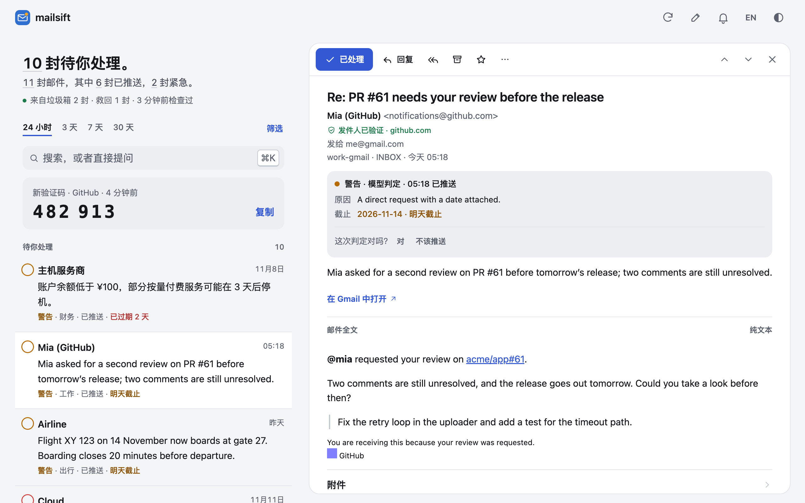
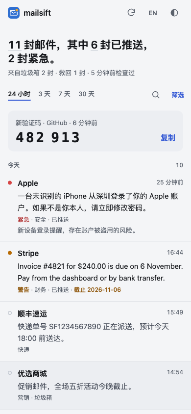

# mailsift（中文说明）

mailsift 统一监控你的所有 IMAP 邮箱，包括垃圾箱。它用你自己的规则和大模型判断每封新邮件，把重要的推送到飞书或通用 Webhook，其余的汇总进每日日报。它的 Web 视图是建立在这些判断之上的邮件客户端：打开就是需要你处理的邮件，阅读、归档、回复都在这里完成。



> mailsift 只读取你的邮件，除非你另外给它一个写令牌，否则不会改动任何东西。有了写令牌，Web 视图可以归档、删除和回复邮件，MCP 可以把邮件标为已处理、加星和归档，每次操作都有审计。通过 MCP 不能发信，也不能删信。分类结果可能有误，请继续以邮箱服务商那里的邮件为准。

English: [README.md](README.md)。详细文档在 [docs/](docs/) 目录，只有英文版。

## 主要功能

- **所有邮箱，包括垃圾箱。** 支持任意 IMAP 服务商和多个账号，Gmail、Outlook 通过 OAuth 接入。垃圾箱按服务商自动识别，和收件箱一样检查。
- **判断，而不只是过滤。** 先按你的发件人规则判定，其余交给大模型评为紧急、警告或一般，并附一句话摘要和理由。没配大模型或它出错时，由关键词规则兜底，邮件照常处理。
- **重要的及时推送。** 重要邮件一被发现就推送到飞书或 Webhook，开启 IMAP IDLE 后几秒内就到；其余的等每日日报。
- **验证码一眼可见。** 验证码直接显示在飞书卡片里，在 Web 视图里则是一个点一下就复制的大号数字。验证码和登录链接都不会发给大模型。
- **建立在分诊之上的邮件客户端。** Web 视图打开就是需要你处理的邮件。安全地按原貌阅读每封邮件；标记完成、归档或回复；就所有邮件向大模型提问。可以添加到手机主屏幕，并在那里收到通知。
- **MCP 服务器**，让 AI 助手可以看到哪些邮件等你处理，并列出、搜索和阅读分诊过的邮件。
- **看不到时会说。** 邮箱或大模型持续失败时会告警；可选的外部心跳能让别处的监控发现 mailsift 自己停了。

## 快速开始

需要 Docker 和 Compose。

```bash
git clone https://github.com/itswl/mailsift.git
cd mailsift
cp .env.example .env
```

编辑 `.env`，至少填好下面几行，其余设置可以先保持 `.env.example` 里的值：

```bash
# 邮箱：服务商|地址|密码。密码通常是授权码或应用专用密码。
MAIL_ACCOUNT_1=qq|me@qq.com|授权码

# 重要邮件推送到哪里：飞书机器人、Webhook（WEBHOOK_URL），或两者都配。
FEISHU_WEBHOOK_URL=https://open.feishu.cn/open-apis/bot/v2/hook/...

# 大模型。Key 留空则只用关键词规则。
LLM_PROVIDER=deepseek
LLM_API_KEY=

# Docker 部署时，MCP 和 Web 视图所在的端口必须设置 token：任意长随机串，
# 例如 `openssl rand -hex 32` 的输出。
MCP_TOKEN=
```

Compose 默认运行 `latest` 镜像。如果想自己决定什么时候升级，再在 `.env` 里固定一个版本，例如 `MAILSIFT_VERSION=0.1.99`，可选版本见 Releases 页面。

启动并查看日志：

```bash
docker compose up -d
docker compose logs -f
```

`docker compose run --rm mailsift node dist/src/main.js --check` 可以只校验配置，不执行轮询。

不用 Docker 时需要 Node 22.5 及以上：`npm install`、`npm run check`，然后 `npm run dev`。

## 常用设置

[.env.example](.env.example) 列出了全部设置并附有简短说明。最常改的是这些：

- `MAIL_ACCOUNT_N_NAME`、`MAIL_ACCOUNT_N_FOLDERS`：邮箱的显示名，以及监控哪些文件夹：`INBOX,spam`（默认）、`all` 或具体文件夹名。
- `MAIL_CONTEXT`：用一句话说明你是谁、希望推送什么。大模型判断每封邮件时都会读它。
- `MAIL_ALWAYS_IMPORTANT`、`MAIL_NEVER_IMPORTANT`：始终标为紧急或一般的发件人，例如 `@bank.com`。
- `PUSH_MIN_IMPORTANCE`：实时推送的最低级别（默认 `warning`）。
- `LLM_OUTPUT_LANGUAGE`：摘要的语言：`en`、`zh-CN`、`auto` 或任意语言名称。
- `DIGEST_HOUR`：日报在服务器时钟上的发送整点（默认 `9`）。记得把 `TZ` 设成你的时区。
- `IMAP_IDLE_ENABLED=true`：新邮件一到就唤醒，不必等下一次轮询。
- `WEB_UI_ENABLED=true`：开启下面的 [Web 视图](#web-视图)。
- `MCP_WRITE_TOKEN`：第二个令牌，有了它 Web 视图和 MCP 才能处理邮件；不设置时 mailsift 只读。

每项的详细说明见 [docs/configuration.md](docs/configuration.md)。

## Gmail / Outlook

大多数 Gmail 和 Outlook 账号需要用 OAuth 而不是密码。添加账号时不填密码（`MAIL_ACCOUNT_2=gmail|me@gmail.com`，或 `outlook|…`），然后授权一次：

```bash
docker compose run --rm mailsift node dist/scripts/oauth-setup.js --manual
```

它会打印一个链接：在任意一台电脑上打开、同意授权，再把跳转后的完整地址粘贴回终端。不用 Docker 时，`npm run oauth` 会在本机浏览器里完成同样的步骤。

Discussions 里有两篇指南讲服务商那边的设置：

- [Gmail / Outlook 的 OAuth 授权](../../discussions/46)，对照代码实际请求的 scope 和回调地址写的，含两个最耗时间的坑：Google 同意屏幕停在「测试」会让 refresh token 每 7 天过期，以及 Outlook.com 默认关闭 IMAP。
- [邮箱转发](../../discussions/47)，讲怎样用整箱转发完全绕开 Gmail 的 OAuth。

个人 Gmail 也可以用 `gmail_pw` 加应用专用密码；Google Workspace 不支持这种方式。

## Web 视图

设置 `WEB_UI_ENABLED=true`，然后打开 `http://<host>:8410/`（即 `MCP_PORT`）。用 `MCP_TOKEN` 登录可以阅读，用 `MCP_WRITE_TOKEN` 登录还可以处理邮件；浏览器会一直保持登录。

- **待处理**排在最前：被判为重要、你还没处理的邮件。点一下圆环、向右滑走，或者点开它。
- **阅读**邮件的原貌。远程图片等你同意才加载，跟踪像素直接丢弃，显示地址与实际去向不一致的链接会被标出，并显示邮箱服务商对发件人的验证结果。
- **处理**：完成、归档、删除、加星、不是垃圾邮件。回复或写新邮件，可以让大模型先起草，发送后五秒内可以撤销。
- **提问**：就所有邮件提一个问题，回答会标出依据的是哪几封。
- **验证码**以大号数字显示，点一下就复制。在手机上，主屏幕的「最新验证码」快捷方式会直接打开最新的验证码，还没到时会等它到。
- **通知**：验证码和重要邮件推送到手机或电脑；邮件一经判定，列表就会更新。
- `⌘K` 打开命令面板，`?` 列出快捷键。



Docker 只把端口发布在宿主机的回环地址上。要从手机访问，请在前面放一个带 TLS 的反向代理（并设置 `TRUSTED_PROXY=true`），或者用隧道；通知和安装到主屏幕都需要 HTTPS。详见 [docs/web-view.md](docs/web-view.md)。

## MCP

MCP 服务器运行在 mailsift 进程内，地址是 `http://127.0.0.1:8410/mcp`（Streamable HTTP，`Authorization: Bearer <MCP_TOKEN>`）。把它加到 MCP 客户端里，AI 助手就能看到哪些邮件等你处理，列出、搜索和阅读分诊过的邮件、预览日报、查看邮箱健康状况。它还以 prompt 的形式提供了这些工具该怎么配合用：盘点收件箱，或者排查某封邮件为什么没通知到你。它默认只读；另设一个 `MCP_WRITE_TOKEN` 后才能把邮件标为已处理、加星、归档和移动，每次操作都有审计。它不能发信，也不能删信。支持 skill 的 agent 可以加载 [.agents/skills/mailsift/SKILL.md](.agents/skills/mailsift/SKILL.md)。详见 [docs/mcp.md](docs/mcp.md)。

## 常用命令

```bash
docker compose logs -f                                          # 查看日志
docker compose pull && docker compose up -d                     # 升级（固定了版本时先调高 MAILSIFT_VERSION）
docker compose run --rm mailsift node dist/src/main.js --check  # 校验配置
```

全部命令和参数见 [docs/deployment.md](docs/deployment.md#commands)。

## 文档（英文）

- [Configuration](docs/configuration.md)：邮箱和文件夹、推送出口、推送阈值、自定义规则、日报、轮询限制、IMAP IDLE、告警。
- [Triage](docs/triage.md)：邮件怎么判定、大模型能看到什么、两段式分诊、降级兜底、验证码和登录链接。
- [Web view](docs/web-view.md)：待处理队列、阅读及其安全措施、处理、写信、提问、通知、快捷键，以及页面如何受到保护。
- [MCP](docs/mcp.md)：工具、资源、写凭证、附件、安全线索、审计。
- [Deployment and operations](docs/deployment.md)：Docker、升级、systemd、OAuth 细节、命令、监控、恢复。
- [Troubleshooting](docs/troubleshooting.md)：常见问题排查。
- [Signal event v1](docs/signal-event-v1.md)：Webhook 载荷里的 `signal` 对象。
- [Development](docs/development.md)：开发、本地预览和发版。

## License

MIT
